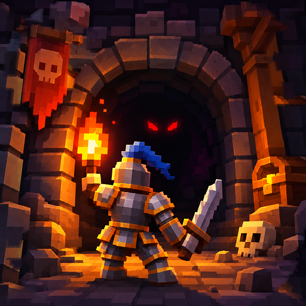

# Crawlspace

A gothic dungeon crawler made for phones. Fight your way down five floors of random mazes, one life, and escape past the Ogre King. It is drawn in low-poly pixel art with real lighting, and the whole game is a single HTML file that runs in the browser.

## Playing

Open `index.html` in a browser, or host this folder on any static site (such as GitHub Pages) and open it on your phone.

On a phone, use **Add to Home Screen**. The game then opens full screen like an app, with its own icon.

## The game

- **Five floors, one life.** Each floor is a new random maze. An enemy always guards the stairs down. On floor 5 the Ogre King guards the exit, and beating him wins the run.
- **The floors:** The Broken Gate, The Drowned Crypt, The Glowing Caverns, The Burning Deep, The Feast Hall. Each has its own fight room, enemies and look.
- **Turn-based fights.** Normal, Heavy or Block against groups of goblins, slimes, skeletons, orcs, trolls, wraiths, Dark Knights, Minotaurs, wyverns and more. Each enemy has its own trick. Every turn plays out blow by blow: you lunge and strike, they reel, then each enemy steps in and answers.
- **Sound and music.** All of it is made in code as you play, with no sound files. Each floor, fights, the Ogre King, the campfire and the merchant have their own music. A blow sounds like what it hits: slimes squelch, bones crack and rattle, flesh thuds, armor rings. Music and sounds can each be switched off.
- **Perk cards.** Every level-up deals three perk cards, tarot style, and you keep one. You can Redraw a hand for coins.
- **Gear and enchantments.** Leather, iron and steel gear shows on your character. Scrolls found in capsae enchant it.
- **Merchants and campfires.** A merchant's wagon stands halfway through floors 2 and 4, and a campfire halfway through floors 3 and 5. Each gives you one visit: once you leave, the wagon rolls on and the fire goes out.
- **The Vault.** Coins you carry out of a winning run go into the Vault, where they buy cosmetic looks for your hero. Open it from the title screen, or straight from the screen at the end of a run.

The full rules are in the game under **How to Play**.

## Files

| File | What it is |
|---|---|
| `index.html` | The whole game: code, art, menus and the How to Play guide |
| `manifest.json` | Home-screen app settings for Android (name, icons, full screen) |
| `crawlspace-icon.png` | The 180 px icon that iPhones and iPads use |
| `crawlspace-icon-192.png`, `crawlspace-icon-512.png` | The browser-tab and Android icons |
| `tools/sim/` | Balance bots that play thousands of headless games ([README](tools/sim/README.md)) |

## Balance testing

The game is tuned so that about 1 run in 10 wins. `tools/sim` runs bots with different playstyles through full games in headless Microsoft Edge and reports win rates and where runs die. It needs Windows PowerShell and Edge. See [tools/sim/README.md](tools/sim/README.md).
